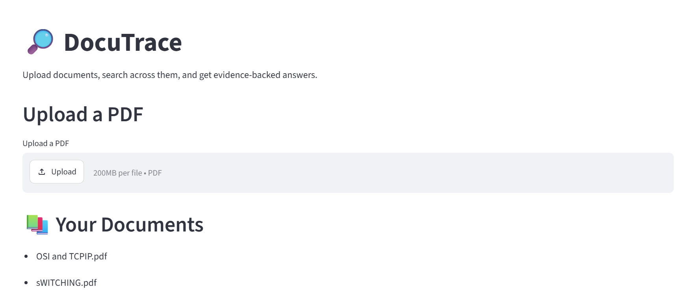
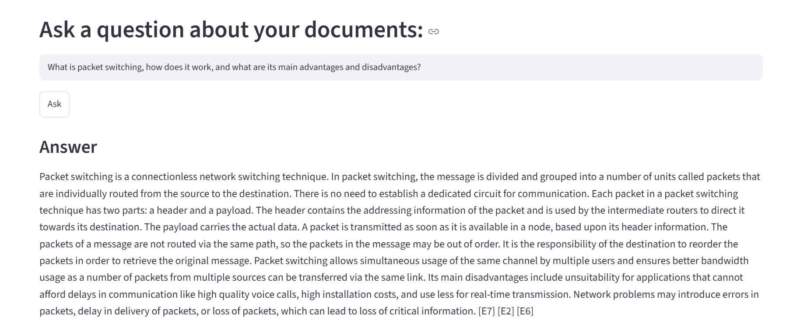
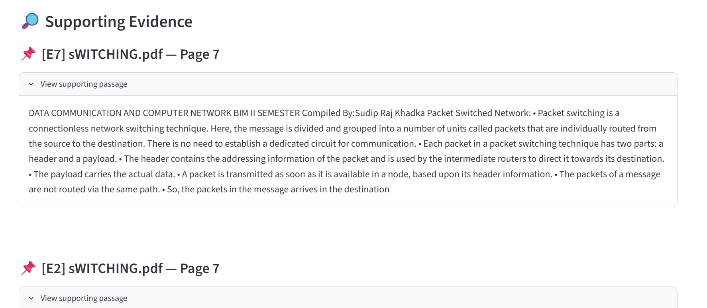
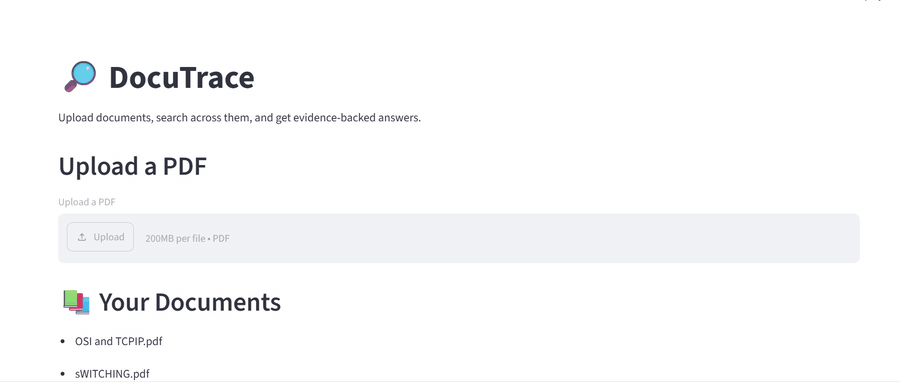
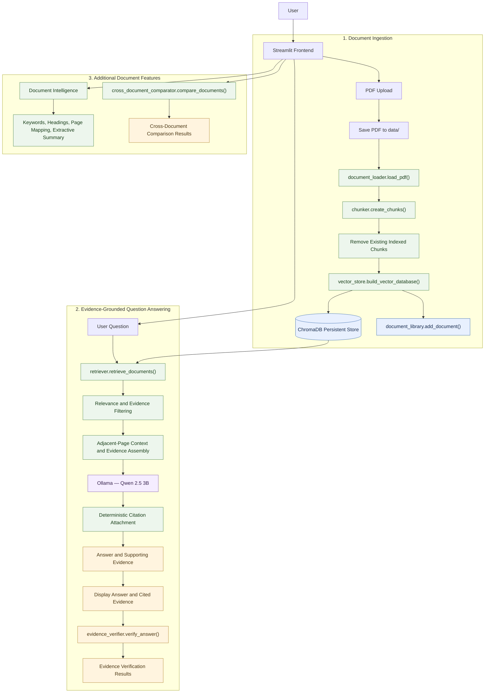

# DocuTrace

### Search. Compare. Trace the Evidence.

**DocuTrace** is an AI-powered document intelligence application that helps users search PDF documents, ask natural-language questions, and compare information across multiple documents using evidence-backed answers.

Built with Python and Streamlit, DocuTrace uses Retrieval-Augmented Generation (RAG), ChromaDB vector search, Sentence Transformers, and a locally running Ollama language model to generate answers grounded in document content, with supporting evidence and page-level citations.

## Key Features

- **PDF Document Processing:** Upload and process PDF documents for searchable content.
- **Semantic Search:** Retrieve relevant document passages using vector embeddings.
- **AI-Powered Question Answering:** Ask natural-language questions about selected documents.
- **Evidence-Backed Responses:** Display supporting passages and page-level citations alongside generated answers.
- **Evidence Verification:** Evaluate answer claims against retrieved document evidence.
- **Multi-Document Comparison:** Compare information across multiple documents using retrieved evidence.
- **Document Library:** Manage and reuse indexed documents.

## Technology Stack

| Technology | Purpose |
|---|---|
| Python | Core application logic |
| Streamlit | Interactive user interface |
| ChromaDB | Vector database and semantic retrieval |
| Sentence Transformers | Text embeddings |
| Ollama | Local language model inference |
| PyPDF | PDF text extraction |
| pytest | Automated testing |

## System Architecture

```text
              PDF Documents
                    |
                    v
             Document Loader
                    |
                    v
          Text Extraction & Cleaning
                    |
                    v
             Text Chunking
                    |
                    v
          Sentence Transformers
                    |
                    v
             ChromaDB Index
                    |
                    v
           Semantic Retrieval
                    |
                    v
              RAG Pipeline
                    |
                    v
              Ollama LLM
                    |
                    v
          Generated Answer
                    |
                    v
       Evidence & Page Citations
                    |
                    v
          Evidence Verification
```

## How It Works

1. **Document ingestion:** PDF files are uploaded and their text is extracted.
2. **Text preprocessing:** Extracted content is cleaned and divided into smaller chunks while preserving page information.
3. **Embedding generation:** Sentence Transformers converts text chunks into vector embeddings.
4. **Vector indexing:** Chunks and their metadata are stored in ChromaDB.
5. **Semantic retrieval:** Relevant passages are retrieved based on the user's question.
6. **Answer generation:** The retrieved context is passed to an Ollama language model to generate an answer.
7. **Evidence verification:** Generated claims are checked against supporting document passages.
8. **Citation presentation:** Users can inspect supporting evidence and its corresponding document pages.

## Installation and Setup

### Prerequisites

- Python 3.11
- Git
- [Ollama](https://ollama.com/)
- A compatible local language model

### 1. Clone the repository

```bash
git clone https://github.com/Prakritibhandari07/docutrace.git
cd docutrace
```

### 2. Create a virtual environment

**Windows PowerShell:**

```powershell
py -3.11 -m venv .venv
.\.venv\Scripts\Activate.ps1
```

### 3. Install dependencies

```powershell
python -m pip install -r requirements.txt
```

### 4. Start Ollama and download the model

```powershell
ollama pull qwen2.5:3b
```

Ensure Ollama is running before starting the application.

### 5. Run DocuTrace

```powershell
python -m streamlit run frontend/streamlit_app.py
```

Open the local URL displayed in your terminal, usually:

`http://localhost:8501`

## Application Screenshots

### Document Library



### Question Answering



### Supporting Evidence and Citations



### Demo



## Architecture

DocuTrace is a Streamlit-based document intelligence and retrieval-augmented generation (RAG) application. It supports PDF ingestion, evidence-grounded question answering, cross-document comparison, and document analysis.



## Technical Stack

| Category | Technology | Purpose |
|---|---|---|
| Programming Language | Python | Core application logic |
| Frontend | Streamlit | Interactive web interface |
| PDF Processing | pypdf | PDF text extraction |
| Text Chunking | LangChain Text Splitters | Recursive document chunking |
| Vector Database | ChromaDB | Persistent document indexing and retrieval |
| LLM Runtime | Ollama | Local language model execution |
| Language Model | Qwen 2.5 3B | Context-based answer generation |
| HTTP Client | Requests | Communication with local LLM services |
| Testing | pytest | Automated application testing |

### Engineering Decisions

- **Local LLM inference:** Runs Qwen 2.5 3B through Ollama.
- **Persistent vector storage:** Uses ChromaDB to retain indexed document chunks.
- **Evidence-grounded generation:** Supplies retrieved document passages as context for answer generation.
- **Deterministic citation matching:** Uses text similarity and keyword overlap to associate answer claims with supporting evidence.
- **Context-aware retrieval:** Retrieves adjacent-page context to help resolve references spanning PDF pages.

### Main components

- **Frontend:** Streamlit interface for uploading documents, asking questions, viewing evidence, and accessing analysis features.
- **Ingestion:** Extracts PDF pages, creates chunks, and stores indexed content in persistent ChromaDB storage.
- **Retrieval:** Finds relevant document passages and filters evidence before answer generation.
- **Answer generation:** Uses Ollama with Qwen 2.5 3B to generate answers from retrieved context.
- **Citation handling:** Attaches citations through deterministic text-similarity and keyword-overlap matching.
- **Evidence verification:** Checks the generated answer against retrieved evidence.
- **Additional features:** Provides document intelligence analysis and cross-document comparison.

## Running Tests

Run the automated test suite from the project root:

```powershell
python -m pytest app -q
```

The current test suite has **60 passing tests and 2 skipped tests**. The skipped tests are optional Ollama integration tests.

## Design Goals

DocuTrace focuses on making document question answering more transparent and inspectable.

Rather than presenting only a generated response, it provides supporting passages and citations so users can examine the source material behind an answer.

## Future Improvements

- Support for scanned PDFs through OCR.
- Improved retrieval and ranking strategies.
- More robust evaluation of generated answers.
- Expanded document formats.
- Deployment and accessibility improvements.

## Author

**Prakriti Bhandari**

- GitHub: [Prakritibhandari07](https://github.com/Prakritibhandari07)
- LinkedIn: [Prakriti Bhandari](https://www.linkedin.com/in/prakriti-bhandari-18pp)